# 🛍️ ShopSmart AI

A full-stack e-commerce platform with AI-powered product search, a multi-vendor seller marketplace, and a complete admin/moderation system.

**Live Demo:** [https://shopsmart-ai-z3cx.onrender.com](https://shopsmart-ai-z3cx.onrender.com)

> The demo runs on Render's free tier, so the first load after a period of inactivity can take around a minute.

---

## 📋 Table of Contents

- [Overview](#-overview)
- [Screenshots](#-screenshots)
- [Features](#-features)
- [Tech Stack](#-tech-stack)
- [Architecture Notes](#️-architecture-notes)
- [Key Design Decisions](#-key-design-decisions)
- [Project Structure](#-project-structure)
- [Local Development Setup](#️-local-development-setup)
- [Running Tests](#-running-tests)
- [Deployment](#-deployment)
- [Payment Notice](#-payment-notice)
- [Known Limitations](#️-known-limitations)
- [License](#-license)

---

## 🚀 Overview

**ShopSmart AI** is a **PERN-stack** (PostgreSQL, Express, React, Node) online store that goes beyond a basic shopping cart. Buyers can search products in **plain English or Hinglish** using Google Gemini, sellers can apply for and run their own storefronts within the platform, and admins have full moderation, reporting, and broadcast-notification tools.

---

## 📸 Screenshots

<table>
  <tr>
    <td width="50%"><strong>Home Page</strong><br/>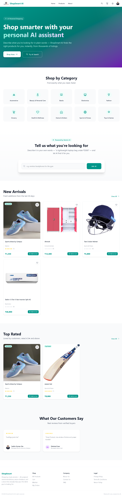</td>
    <td width="50%"><strong>AI Search Results</strong><br/>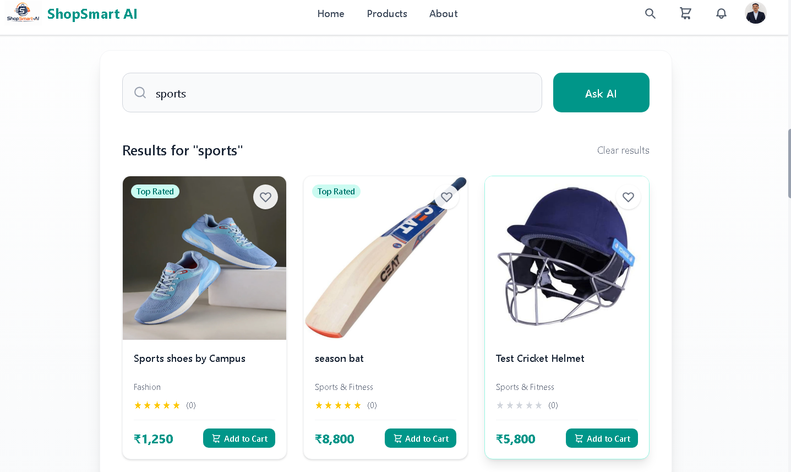</td>
  </tr>
  <tr>
    <td width="50%"><strong>Checkout</strong><br/>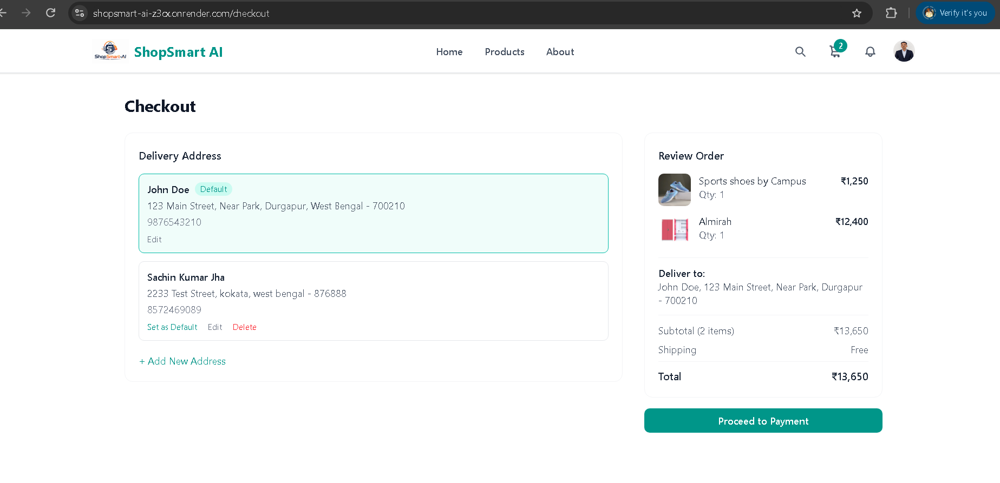</td>
    <td width="50%"><strong>Order Detail (Buyer View)</strong><br/>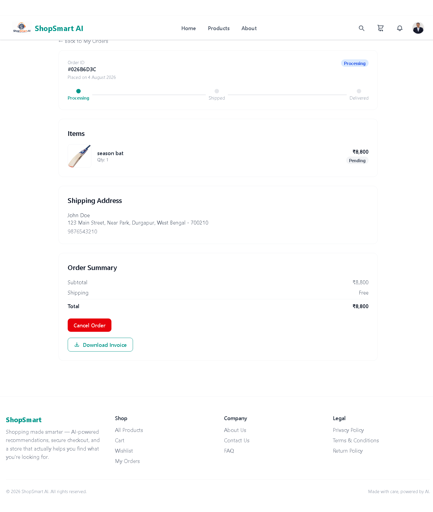</td>
  </tr>
  <tr>
    <td width="50%"><strong>Admin Dashboard</strong><br/>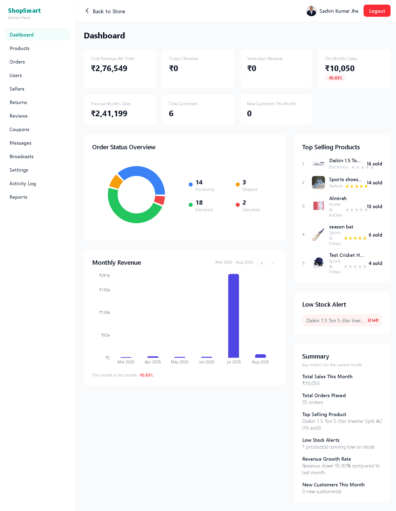</td>
    <td width="50%"><strong>Admin — Orders</strong><br/>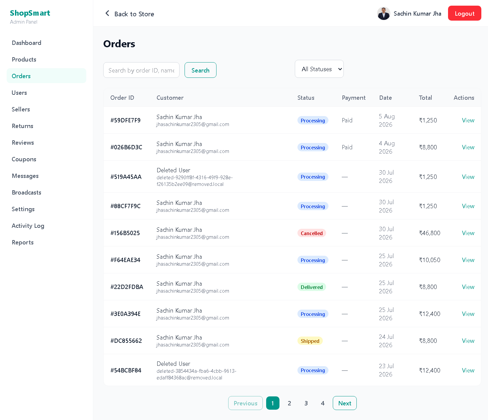</td>
  </tr>
  <tr>
    <td width="50%"><strong>Admin — Reports</strong><br/>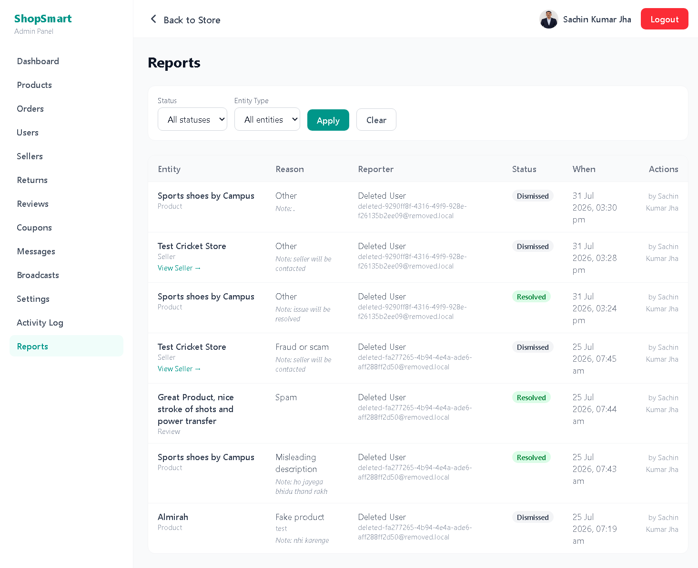</td>
    <td width="50%"><strong>Admin — Activity Log</strong><br/>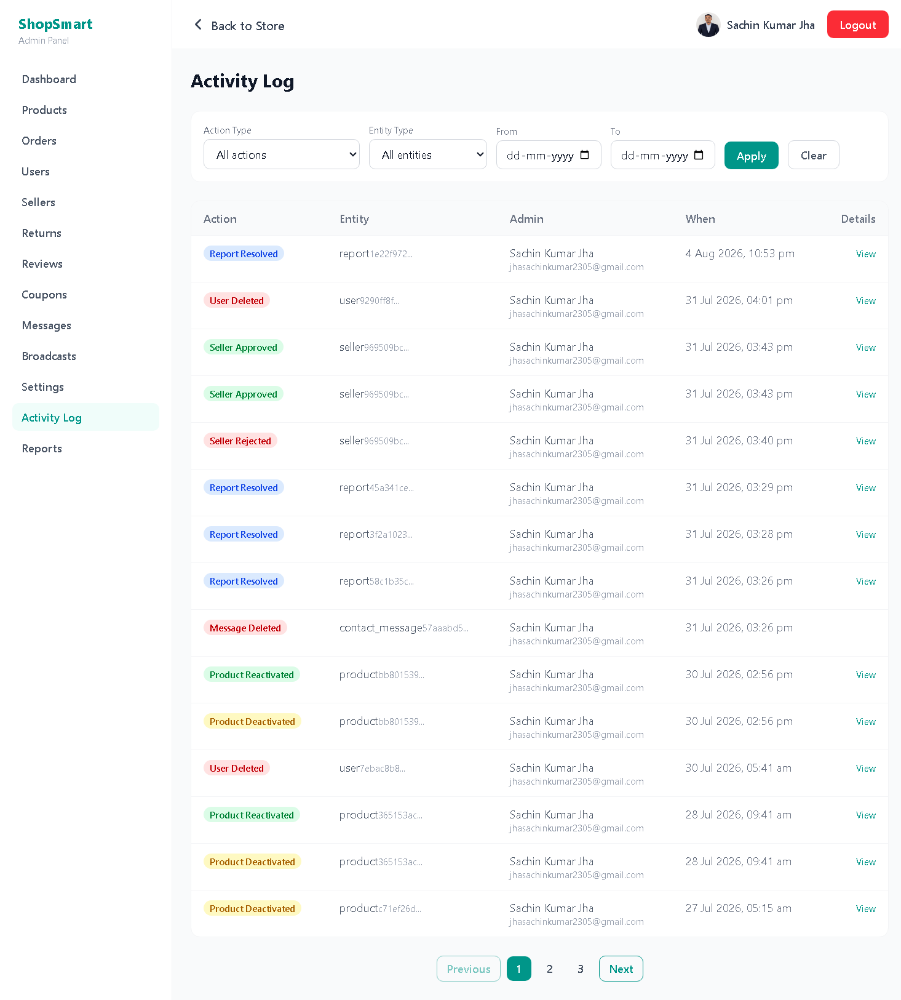</td>
  </tr>
</table>

---

## ✨ Features

### 🔐 Authentication
- JWT-based authentication with **httpOnly cookies**
- **Google Sign-In** (OAuth) integration
- Email verification via a **pending-registration flow** (accounts aren't created until the verification link is clicked)

### 🤖 AI-Powered Search
- Natural language / Hinglish product search using **Google Gemini (`gemini-2.5-flash`)**
- Intelligent product discovery beyond keyword matching, with a keyword-search fallback if the AI call fails

### 🛒 Shopping & Checkout
- Per-user cart with **stock-aware quantity caps**
- Wishlist functionality
- Multiple saved addresses
- Coupon system (platform-wide and seller-scoped)
- **Razorpay** payments with signature-verified webhooks **(configured in test/demo mode — no real money is processed)**

### 📦 Order Management
- Full lifecycle tracking: **Processing → Shipped → Delivered**
- Buyers can cancel an order while it is still **Processing**; sellers can cancel individual items; paid cancellations are refunded through Razorpay
- Per-item return requests within a **7-day window** after delivery

### 🏪 Multi-Vendor Marketplace
- Seller applications with admin approval/rejection
- Cooldown periods for reapplying
- Seller-scoped coupons
- Seller ratings separate from product reviews

### ⭐ Reviews & Ratings
- Product reviews gated on **verified delivery**
- Seller ratings are a single upsertable rating per buyer-seller pair (not per-order)

### 🔔 Notifications
- Personal notifications (order updates, report resolutions)
- Admin broadcast announcements with **audience targeting** and expiry

### 🛠️ Admin Panel
- Dashboard stats
- User/seller/product/report management
- Activity log
- Admin-secret-gated account deletion with a **last-admin safety block**

### 📄 Invoices
- PDF invoice generation and download per order

---

## 🧰 Tech Stack

| Category | Tools |
|----------|-------|
| **Frontend** | React + Vite + Tailwind CSS v4 + Redux Toolkit + React Router |
| **Backend** | Node.js + Express + PostgreSQL (raw SQL via `pg`, no ORM) |
| **Authentication** | JWT (httpOnly cookies) + Google OAuth |
| **Image Storage** | Cloudinary |
| **AI** | Google Gemini API |
| **Payments** | Razorpay (test/demo mode — no real transactions) |
| **Testing** | Jest + Supertest (backend), Vitest + React Testing Library (frontend) |
| **Hosting** | Render (single web service) + Supabase (managed PostgreSQL) |

---

## 🏗️ Architecture Notes

### System Architecture

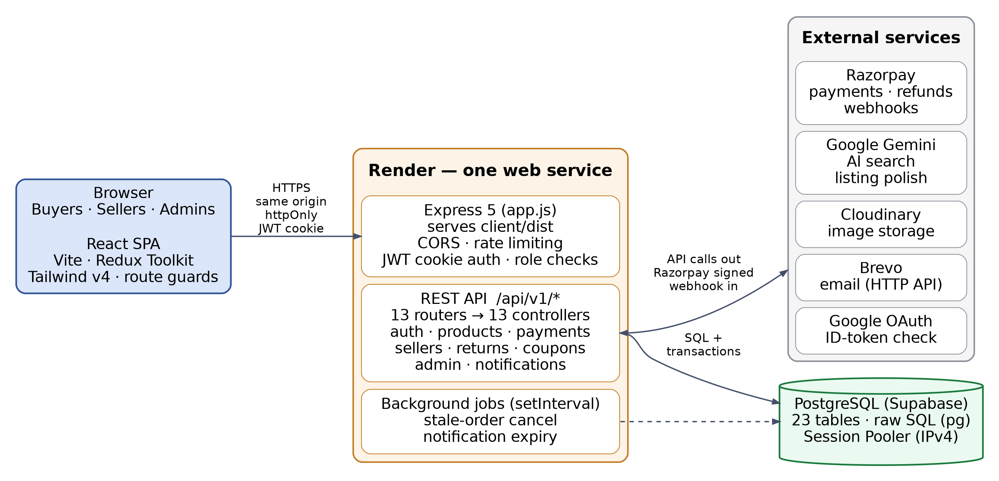

One Express process serves both the built React app and the JSON API, so the browser only ever talks to a single origin.

### Database ER Diagram

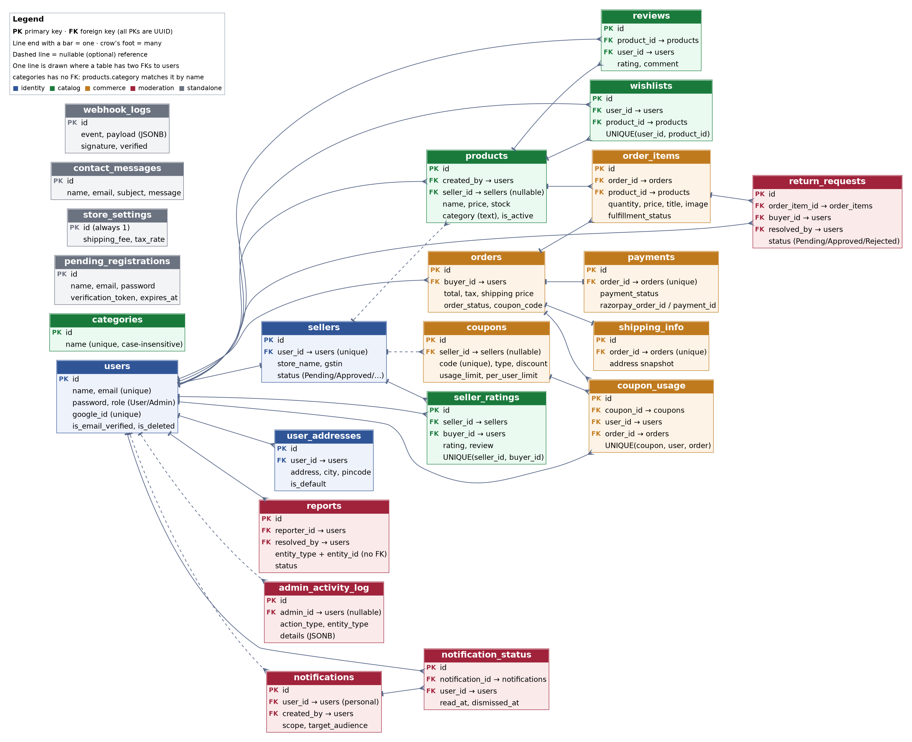

23 tables and 29 foreign keys. Click the image to enlarge.

### Data Flow Diagram

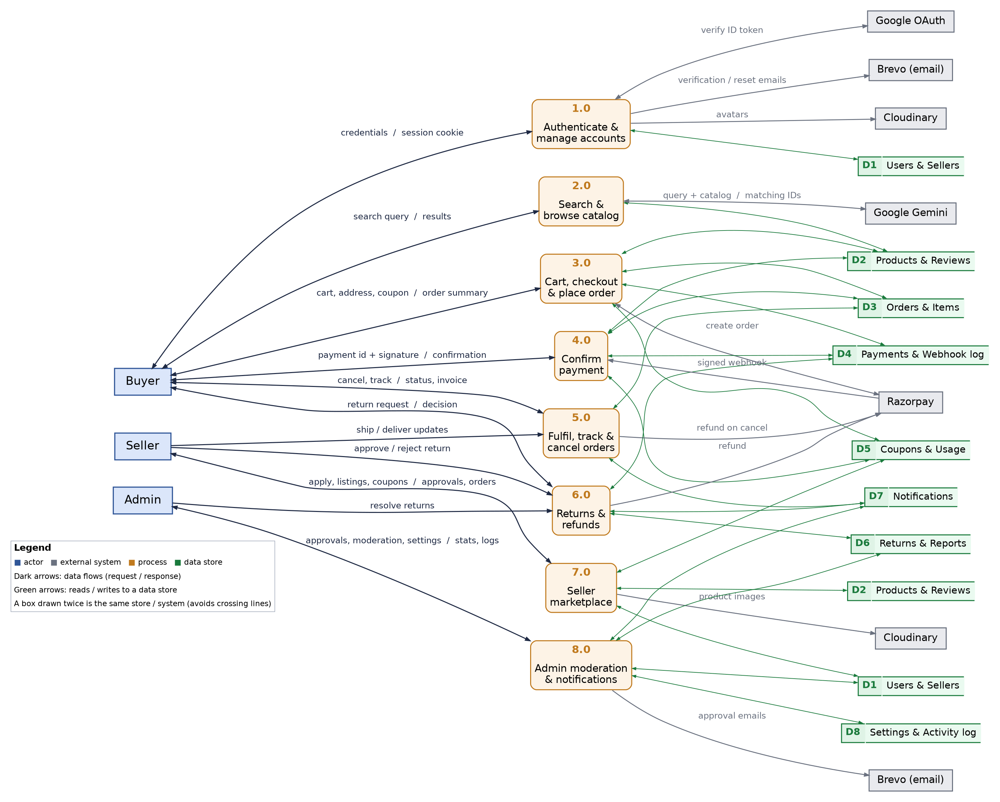

Level-1 view of how buyer, seller and admin requests move through the eight main processes, the data stores they read and write, and the external services they call. Click the image to enlarge.

### Payment Flow

1. The buyer clicks **Pay Now** and the client calls `POST /api/v1/payment/create-order`.
2. The server re-validates prices, stock, coupon and tax inside a database transaction, creates the Razorpay order, and stores the order with a `Pending` payment.
3. The client opens Razorpay Checkout and the buyer pays.
4. The client sends the payment ID and signature to `POST /api/v1/payment/verify`, and the server recomputes the HMAC-SHA256 signature and compares it.
5. In one transaction the server marks the payment `Paid`, decrements stock and records coupon use.
6. Independently, Razorpay calls `POST /api/v1/payment/webhook` with a signed event. It runs the same guarded update, so stock is decremented only once even if both paths arrive.

### Same-Origin Deployment Strategy

The frontend and backend are deployed as a **single Render web service** rather than two separate services:

- Express serves the built React app (`client/dist`) as static files
- Handles all `/api/v1/...` routes on the same origin

**Why this approach?**

> Hosting them on separate domains (e.g., `frontend.onrender.com` and `backend.onrender.com`) causes modern browsers to treat authentication cookies as **third-party** and block them. Same-origin serving avoids this entirely without needing a custom domain or switching away from cookie-based auth.

### Database Connectivity

The database connection uses **Supabase's Session Pooler** (IPv4-compatible) rather than its direct connection, since Render's free tier and most home networks can't reach Supabase's IPv6-only direct connection endpoint.

Tables are created automatically on server startup (`server/utils/createTables.js`) — no separate migration step.

---

## 🎯 Key Design Decisions

- **Server-authoritative checkout** — prices, stock, coupons and tax are re-validated server-side inside a database transaction; order items snapshot price, title and image so past orders stay accurate after a product changes.
- **Atomic stock decrement** — `UPDATE products SET stock = stock - $1 WHERE id = $2 AND stock >= $1` prevents overselling, verified by the concurrency test below.
- **Race-proof constraints in the database** — partial unique indexes guarantee at most one pending return per order item and one pending report per reporter and target, even under concurrent requests.
- **Two-path payment confirmation** — signature-checked browser callback plus signature-checked webhook, made idempotent so a payment can't be applied twice.
- **AI is advisory only** — Gemini returns product IDs, which are matched against catalog data fetched from the database; it never supplies prices or product details. If the AI call fails, search falls back to keyword matching.
- **Account deletion anonymizes** — the user row is kept (name, email, credentials and avatar are wiped) so order history stays intact for sellers.

---

## 📁 Project Structure

<details>
<summary><strong>Click to expand the full project structure</strong></summary>

```
ShopSmart-AI/
├── client/
│   ├── .env
│   ├── .oxlintrc.json                          # Oxlint configuration
│   ├── index.html                              # HTML template
│   ├── package.json
│   ├── vite.config.js                          # Vite configuration
│   ├── public/
│   │   ├── favicon.svg
│   │   ├── icons.svg
│   │   └── logo.png
│   └── src/
│       ├── api/                                # Axios calls per feature
│       │   ├── addressApi.js
│       │   ├── adminApi.js
│       │   ├── authApi.js
│       │   ├── contactApi.js
│       │   ├── couponApi.js
│       │   ├── notificationApi.js
│       │   ├── orderApi.js
│       │   ├── productApi.js
│       │   ├── reportApi.js
│       │   ├── returnApi.js
│       │   ├── sellerApi.js
│       │   ├── settingsApi.js
│       │   └── wishlistApi.js
│       ├── assets/
│       │   └── images/
│       │       └── logo.png
│       ├── components/
│       │   ├── address/
│       │   │   ├── AddressCard.jsx
│       │   │   └── AddressModal.jsx
│       │   ├── admin/
│       │   │   ├── AdminLayout.jsx
│       │   │   ├── AdminNavbar.jsx
│       │   │   ├── AdminSidebar.jsx
│       │   │   ├── CouponModal.jsx
│       │   │   ├── DashboardSummary.jsx
│       │   │   ├── LowStockAlert.jsx
│       │   │   ├── OrderStatusPieChart.jsx
│       │   │   ├── RevenueChart.jsx
│       │   │   ├── StatsCard.jsx
│       │   │   └── TopProductsTable.jsx
│       │   ├── auth/
│       │   │   ├── GoogleLoginButton.jsx
│       │   │   ├── LoginModal.jsx
│       │   │   └── RegisterModal.jsx
│       │   ├── cart/
│       │   │   ├── CartItem.jsx
│       │   │   ├── CartSummary.jsx
│       │   │   └── CouponInput.jsx
│       │   ├── checkout/
│       │   │   ├── AddressForm.jsx
│       │   │   ├── AddressSelector.jsx
│       │   │   ├── OrderSummary.jsx
│       │   │   └── RazorpayButton.jsx
│       │   ├── home/
│       │   │   ├── AISearchBar.jsx
│       │   │   ├── CategoryGrid.jsx
│       │   │   ├── FeaturedProducts.jsx
│       │   │   ├── HeroBanner.jsx
│       │   │   └── TestimonialsSection.jsx
│       │   ├── layout/
│       │   │   ├── CartDrawer.jsx
│       │   │   ├── Footer.jsx
│       │   │   ├── Navbar.jsx
│       │   │   ├── NotificationBell.jsx
│       │   │   └── ScrollToTop.jsx
│       │   ├── order/
│       │   │   ├── OrderCard.jsx
│       │   │   ├── OrderStatusBadge.jsx
│       │   │   ├── OrderTimeline.jsx
│       │   │   ├── RateSellerModal.jsx
│       │   │   └── RequestReturnModal.jsx
│       │   ├── product/
│       │   │   ├── AIDescriptionHelper.jsx
│       │   │   ├── ProductCard.jsx
│       │   │   ├── ProductCarousel.jsx
│       │   │   ├── ProductFilters.jsx
│       │   │   ├── ProductGrid.jsx
│       │   │   ├── ReviewCard.jsx
│       │   │   └── ReviewForm.jsx
│       │   ├── profile/
│       │   │   ├── AvatarUpload.jsx
│       │   │   ├── DeleteAccountSection.jsx
│       │   │   ├── PasswordForm.jsx
│       │   │   └── ProfileForm.jsx
│       │   ├── report/
│       │   │   └── ReportButton.jsx
│       │   ├── returns/
│       │   │   └── ReturnRequestList.jsx
│       │   ├── seller/
│       │   │   ├── SellerCouponModal.jsx
│       │   │   ├── SellerLayout.jsx
│       │   │   ├── SellerNavbar.jsx
│       │   │   └── SellerSidebar.jsx
│       │   ├── ui/
│       │   │   ├── Badge.jsx
│       │   │   ├── Breadcrumb.jsx
│       │   │   ├── Button.jsx
│       │   │   ├── ConfirmDialog.jsx
│       │   │   ├── DetailPageSkeleton.jsx
│       │   │   ├── ImageCarousel.jsx
│       │   │   ├── Input.jsx
│       │   │   ├── Loader.jsx
│       │   │   ├── Modal.jsx
│       │   │   ├── Pagination.jsx
│       │   │   ├── StarRating.jsx
│       │   │   ├── TableSkeleton.jsx
│       │   │   └── Tooltip.jsx
│       │   └── wishlist/
│       │       ├── WishlistButton.jsx
│       │       └── WishlistCard.jsx
│       ├── hooks/
│       │   ├── useAuth.js
│       │   ├── useCart.js
│       │   └── useRazorpay.js
│       ├── lib/
│       │   └── axios.js                        # Configured axios instance
│       ├── pages/
│       │   ├── About.jsx
│       │   ├── Addresses.jsx
│       │   ├── BecomeSeller.jsx
│       │   ├── Cart.jsx
│       │   ├── Checkout.jsx
│       │   ├── ContactUs.jsx
│       │   ├── FAQ.jsx
│       │   ├── ForgotPassword.jsx
│       │   ├── Home.jsx
│       │   ├── NotFound.jsx
│       │   ├── NotificationInbox.jsx
│       │   ├── OrderDetail.jsx
│       │   ├── Orders.jsx
│       │   ├── PaymentFailed.jsx
│       │   ├── PaymentSuccess.jsx
│       │   ├── PrivacyPolicy.jsx
│       │   ├── ProductDetail.jsx
│       │   ├── Products.jsx
│       │   ├── Profile.jsx
│       │   ├── ResetPassword.jsx
│       │   ├── ReturnPolicy.jsx
│       │   ├── SearchResults.jsx
│       │   ├── SellerProfile.jsx
│       │   ├── TermsAndConditions.jsx
│       │   ├── UpdatePassword.jsx
│       │   ├── VerifyEmail.jsx
│       │   ├── VerifyEmailChange.jsx
│       │   ├── Wishlist.jsx
│       │   ├── admin/
│       │   │   ├── ActivityLog.jsx
│       │   │   ├── AddProduct.jsx
│       │   │   ├── Broadcasts.jsx
│       │   │   ├── Coupons.jsx
│       │   │   ├── Dashboard.jsx
│       │   │   ├── EditProduct.jsx
│       │   │   ├── Messages.jsx
│       │   │   ├── OrderDetail.jsx
│       │   │   ├── Orders.jsx
│       │   │   ├── Products.jsx
│       │   │   ├── Reports.jsx
│       │   │   ├── Returns.jsx
│       │   │   ├── Reviews.jsx
│       │   │   ├── SellerDetail.jsx
│       │   │   ├── Sellers.jsx
│       │   │   ├── Settings.jsx
│       │   │   └── Users.jsx
│       │   └── seller/
│       │       ├── AddProduct.jsx
│       │       ├── Coupons.jsx
│       │       ├── EditProduct.jsx
│       │       ├── Returns.jsx
│       │       ├── SellerDashboard.jsx
│       │       ├── SellerOrderDetail.jsx
│       │       ├── SellerOrders.jsx
│       │       └── SellerProducts.jsx
│       ├── routes/
│       │   ├── AdminRoute.jsx
│       │   ├── PrivateRoute.jsx
│       │   ├── PublicRoute.jsx
│       │   └── SellerRoute.jsx
│       ├── store/
│       │   ├── store.js
│       │   └── slices/
│       │       ├── addressSlice.js
│       │       ├── adminSlice.js
│       │       ├── authSlice.js
│       │       ├── cartSlice.js
│       │       ├── contactSlice.js
│       │       ├── couponSlice.js
│       │       ├── notificationSlice.js
│       │       ├── orderSlice.js
│       │       ├── productSlice.js
│       │       ├── reportSlice.js
│       │       ├── returnSlice.js
│       │       ├── sellerSlice.js
│       │       ├── settingsSlice.js
│       │       ├── uiSlice.js
│       │       └── wishlistSlice.js
│       ├── tests/                              # Vitest + RTL tests
│       │   ├── AdminRoute.test.jsx
│       │   ├── authSlice.test.js
│       │   ├── cartSlice.test.js
│       │   ├── couponSlice.test.js
│       │   ├── logout.test.js
│       │   ├── PrivateRoute.test.jsx
│       │   └── setupTests.js
│       ├── App.jsx
│       ├── index.css
│       └── main.jsx
│
├── server/
│   ├── app.js                                  # Express app config, middleware, routes, static frontend serving
│   ├── server.js                               # Entry point — starts the server, background intervals
│   ├── concurrency-test.mjs                    # Overselling check (see Running Tests)
│   ├── jest.config.js
│   ├── jsconfig.json
│   ├── package.json
│   ├── config/
│   │   └── config.env                          # Environment variables (not committed)
│   ├── controllers/
│   │   ├── addressControllers.js
│   │   ├── adminControllers.js
│   │   ├── authControllers.js
│   │   ├── contactControllers.js
│   │   ├── couponControllers.js
│   │   ├── notificationControllers.js
│   │   ├── paymentControllers.js
│   │   ├── productControllers.js
│   │   ├── reportControllers.js
│   │   ├── returnControllers.js
│   │   ├── sellerControllers.js
│   │   ├── settingsControllers.js
│   │   └── wishlistControllers.js
│   ├── database/
│   │   └── db.js                               # PostgreSQL connection pool
│   ├── middlewares/
│   │   ├── authMiddleware.js
│   │   ├── catchAsyncError.js
│   │   └── errorMiddleware.js
│   ├── models/                                 # Table-creation SQL, one file per table
│   │   ├── addressTable.js
│   │   ├── adminActivityLogTable.js
│   │   ├── categoryTable.js
│   │   ├── contactMessagesTable.js
│   │   ├── couponTable.js
│   │   ├── notificationsTable.js
│   │   ├── orderItemsTable.js
│   │   ├── ordersTable.js
│   │   ├── paymentsTable.js
│   │   ├── pendingRegistrationsTable.js
│   │   ├── productReviewsTable.js
│   │   ├── productTable.js
│   │   ├── reportsTable.js
│   │   ├── returnRequestsTable.js
│   │   ├── sellerRatingsTable.js
│   │   ├── sellersTable.js
│   │   ├── shipping_info.js
│   │   ├── storeSettingsTable.js
│   │   ├── userTable.js
│   │   └── wishlistTable.js
│   ├── router/
│   │   ├── addressRoutes.js
│   │   ├── adminRoutes.js
│   │   ├── authRoutes.js
│   │   ├── contactRoutes.js
│   │   ├── couponRoutes.js
│   │   ├── notificationRoutes.js
│   │   ├── paymentRoutes.js
│   │   ├── productRoutes.js
│   │   ├── reportRoutes.js
│   │   ├── returnRoutes.js
│   │   ├── sellerRoutes.js
│   │   ├── settingsRoutes.js
│   │   └── wishlistRoutes.js
│   ├── tests/                                  # Jest + Supertest tests
│   │   ├── auth.test.js
│   │   ├── authorization.test.js
│   │   ├── coupon.test.js
│   │   ├── order.test.js
│   │   ├── payment.test.js
│   │   ├── return.test.js
│   │   ├── setupEnv.js
│   │   ├── testSignature.js
│   │   └── webhook.test.js
│   ├── uploads/                                # Temp file-upload staging (runtime generated, not tracked)
│   └── utils/
│       ├── adminActivityLogger.js
│       ├── anonymizeUser.js
│       ├── applyPaymentSuccessEffects.js
│       ├── autoCancelStaleOrders.js
│       ├── autoExpireNotifications.js
│       ├── createTables.js
│       ├── generateForgotPasswordEmailTemplate.js
│       ├── generateInvoice.js
│       ├── generateProductDescription.js
│       ├── generateResetPasswordToken.js
│       ├── getAIRecommendation.js
│       ├── jwtToken.js
│       ├── passwordValidation.js
│       └── sendEmail.js
│
└── README.md
```

</details>

---

## 🛠️ Local Development Setup

### Prerequisites

- Node.js (v18 or higher)
- PostgreSQL (v13 or higher, running locally)
- Accounts/API keys for: Cloudinary, Google Gemini, Razorpay (test mode), Google OAuth, Brevo (free tier — used for transactional emails; requires a verified single sender)

### Backend Setup

1. Navigate to the server directory and install dependencies:

```bash
cd server
npm install
```

2. Create `server/config/config.env` with the following variables:

```env
PORT=1920
FRONTEND_URL=http://localhost:5173
DASHBOARD_URL=http://localhost:5173
JWT_EXPIRES_IN=30d
COOKIE_EXPIRES_IN=30
JWT_SECRET_KEY=your_jwt_secret
BREVO_API_KEY=your_brevo_api_key
BREVO_FROM_EMAIL=your_verified_sender_email@gmail.com
GEMINI_API_KEY=your_gemini_api_key
CLOUDINARY_CLIENT_NAME=your_cloudinary_name
CLOUDINARY_CLIENT_API=your_cloudinary_api_key
CLOUDINARY_CLIENT_SECRET=your_cloudinary_secret
RAZORPAY_SECRET_KEY=your_razorpay_secret
RAZORPAY_FRONTEND_KEY=your_razorpay_test_key
RAZORPAY_WEBHOOK_SECRET=your_webhook_secret
DB_USER=postgres
DB_PASSWORD=your_local_db_password
DB_HOST=localhost
DB_NAME=your_local_db_name
DB_PORT=5432
GOOGLE_CLIENT_ID=your_google_oauth_client_id
```

3. Start the backend server:

```bash
npm run dev
```

> Database tables are created automatically on startup.

4. (Optional) **Get an admin account.** New accounts are regular users, so to try the admin panel (and approve seller applications), sign up in the app, then promote that account:

```bash
psql -U postgres -d your_local_db_name -c "UPDATE users SET role = 'Admin' WHERE email = 'your_email@example.com';"
```

> Email sign-up requires a working Brevo key to receive the verification link; Google Sign-In creates a verified account directly.

### Frontend Setup

1. Navigate to the client directory and install dependencies:

```bash
cd client
npm install
```

2. Create `client/.env` with:

```env
VITE_BACKEND_URL=http://localhost:1920
VITE_GOOGLE_CLIENT_ID=your_google_oauth_client_id
```

3. Start the frontend dev server:

```bash
npm run dev
```

The app will be available at `http://localhost:5173` (or the next available port).

> **Notes for local runs**
> - Razorpay webhooks can't reach `localhost`, so locally a payment is confirmed through the browser callback only. To test webhooks, expose the server with a tunnel (e.g. ngrok) and register that URL in Razorpay.
> - If `GEMINI_API_KEY` is missing or the Gemini call fails, search falls back to keyword matching.

---

## 🧪 Running Tests

**Backend (Jest + Supertest):**

The backend tests use their own database, configured in `server/tests/setupEnv.js` (`shopsmart_test` on `localhost:5432`, user `postgres`, password `1234`). Create it once — tables are created automatically when the app loads — or edit `setupEnv.js` to match your local credentials:

```bash
createdb -U postgres shopsmart_test
```

Then:

```bash
cd server
npm test
```

**Frontend (Vitest + React Testing Library):**

```bash
cd client
npm test
```

### Concurrency Verification (Optional)

`server/concurrency-test.mjs` verifies that the checkout stock-decrement logic prevents overselling under concurrent load, by firing 200 simultaneous purchase attempts at a product with limited stock and confirming stock never goes negative.

Example result from a local run: 12 units in stock, 200 simultaneous attempts → 12 succeeded, 188 correctly rejected, 0 oversold.

To run it: set a real product ID (from your local database) as `TEST_PRODUCT_ID` in `server/config/config.env`, then:

```bash
cd server
node concurrency-test.mjs
```

> The script really decrements that product's stock, so run it against a local database and a throwaway test product.

---

## 🚀 Deployment

Deployed on **Render** (single web service) with **Supabase** as the managed PostgreSQL database.

**Build process:**
1. Installs both `client` and `server` dependencies
2. Runs `vite build` to produce the static frontend (`client/dist`)
3. Express serves the static frontend alongside the API from the same origin

**Why same-origin?** This avoids cookie-related issues that arise when frontend and backend are on separate domains — see [Architecture Notes](#️-architecture-notes) above.

---

## 💳 Payment Notice

**This is a demo project.** All payments are processed through Razorpay's **test mode** using mock card details. No real transactions are processed, and no actual money is charged.

For testing payments, use Razorpay's test card details:
- **Card Number:** `4111 1111 1111 1111`
- **Expiry:** Any future date
- **CVV:** Any 3 digits
- **OTP:** `1234` (or any 4 digits)

---

## ⚠️ Known Limitations

- **Phone/OTP login** — was shelved due to the absence of a free SMS provider at this project's stage.
- **Local network testing** — testing on physical mobile devices over the local network was blocked by firewall/network-profile restrictions. The production deployment (HTTPS-enabled public URL) sidesteps this issue entirely; responsive design tools in DevTools were used for mobile testing during development instead.
- **Email delivery** — Render's free tier blocks outbound SMTP traffic entirely (a common anti-abuse restriction on free hosting tiers), so the app uses [Brevo](https://www.brevo.com)'s HTTP-based email API in production instead of traditional SMTP.
- **No CSRF token** — cross-site requests are limited by CORS origin restrictions and JSON-only bodies, not a dedicated token.
- **Client-side rendering only** — no SSR, so every product page shares one generic title and description for crawlers and link previews.
- **Background jobs use `setInterval`** — stale-order cancellation and notification expiry run inside the single Node process and would need a real scheduler to work across multiple instances.
- **AI search is capped** — each query sends up to 200 in-stock products to Gemini, which won't scale to very large catalogs.

---

## 📄 License

This project was built for educational purposes as a campus project.
